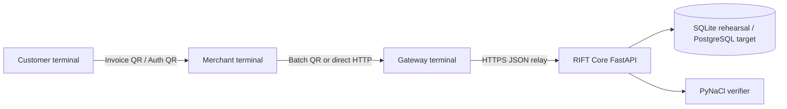

# Architecture

## System shape

RIFT is an asynchronous store-and-forward system with three edge terminals and one authoritative core.

## Components

### Customer terminal (`bank/src/screens/*`, `bank/src/rift/*`)

- React state-driven navigation, not a router.
- Contexts: `PrefsProvider`, `RoleProvider`, `BankProvider`, `ToastProvider`.
- Responsibility: lock funds, store OAC, sign authorisations, display QR and raw token, reconcile.
- Persistence: mock bank state in `localStorage['devions-bank-state-v1']`; protocol state in IndexedDB `rift_edge_db`.

### Merchant terminal (`bank/src/rift/MerchantApp.tsx`)

- Tabs: Till, Receipts, Sync & relay.
- Creates invoice QR, scans or pastes customer authorisation, verifies locally, writes outbox, exports batch chunks, relays directly when online.
- Uses `QRCodeSVG` for invoice, auth and batch QR rendering.

### Gateway terminal (`bank/src/rift/GatewayApp.tsx`)

- Relay node persona. Does not hold bank balances.
- Ingests merchant batch QR chunks or pasted full JSON; reassembles; stores in shared IndexedDB outbox; relays online; displays settlement ledger.
- "Pull demo batch" is a single-device stage shortcut.

### RIFT Core (`rehearsal/backend/app`)

- `main.py` mounts routers under `/api/v1`, configures CORS and exception handlers.
- `routers/` define HTTP surface.
- `schemas.py` defines Pydantic request/response contracts.
- `services/ingestion.py` performs verification, anti-replay, ledger mutation and settlement.
- `services/ledger.py` generates account/merchant codes and clearing references; writes audit rows.
- `crypto.py` canonicalizes payloads, signs/verifies Ed25519 and derives transaction IDs.
- `models.py` defines SQLAlchemy tables.
- `config.py` loads environment via pydantic-settings.

### Protocol libraries

Both clients contain near-identical libraries:

- `crypto.ts` — Ed25519 keys, canonical JSON, signatures, transaction ID.
- `qr-codec.ts` — invoice QR JSON and compact auth QR v2 binary.
- `verify.ts` — offline verification.
- `api.ts` — typed REST client.
- `network.ts` — outbox flush and polling.
- `db.ts` — IndexedDB stores via `idb`.
- `reconcile.ts`, `balance.ts`, `format.ts`.
- Bank-only `batch-codec.ts` for optical batch chunking.

## Dependency order for rebuild

1. Domain types and canonical serialization.
2. Crypto (keygen, sign, verify, transaction ID).
3. Database models / IndexedDB schema.
4. API schemas and client.
5. Core endpoints and ingestion service.
6. Protocol engine shared by roles.
7. Design system and shell.
8. Role screens and flows.
9. Tests and screenshots comparison.

## Trust boundaries

- Edge devices are untrusted; keys and receipts can be extracted or cloned.
- QR channel is public; replay is prevented by nonces, deterministic transaction IDs and sequence checks.
- Core is authoritative; it re-verifies signatures and enforces ledger invariants.
- Bearer tokens are public account IDs in this rehearsal, not secrets. Production must replace them with real authentication.

## Mode model

- `detectMode()` probes `/api/v1/health` with a 15-second cache and 2.5-second timeout.
- Live requires `issuer_key_loaded === true`.
- Failure calls `forceDemoMode()`; sticky until page reload or `resetModeCache()`.
- Mode changes dispatch `rift-mode-change` CustomEvent.

## State ownership

| State | Location | Notes |
| --- | --- | --- |
| Role | `localStorage['devions-role-v1']` | Customer / merchant / gateway |
| Preferences | `localStorage['devions-bank-prefs-v1']` | Theme, sound, hide balance, notifications, app lock |
| Mock bank balances/activity | `localStorage['devions-bank-state-v1']` | Product UI only |
| Demo issuer and demo core | `localStorage['devions-demo-issuer-v1']`, `devions-demo-core-v1` | Demo mode only |
| Last auth/batch shortcuts | `devions-last-auth-v1`, `devions-last-batch-v1` | Single-device stage mode |
| Protocol identities, OACs, invoices, outbox, audit | IndexedDB `rift_edge_db` | Shared by roles in one browser |

## Browser/runtime requirements

- Chromium/WebKit PWA; camera requires secure context (`https` or `localhost`).
- IndexedDB, Web Crypto, WebAudio (optional sound), Service Workers.
- Node 20+ and npm for frontend builds; Python 3.11+ for backend.
