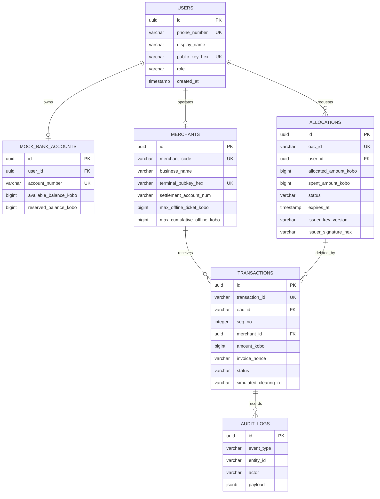

# Database ERD

## Integrity rules

- `users.public_key_hex` and `users.phone_number` are unique.
- `mock_bank_accounts.user_id` is unique; each user has one mock account.
- Merchant `id` equals the owning user's `id` in application code.
- `allocations.oac_id` is unique.
- `transactions.transaction_id` is unique.
- `(transactions.oac_id, transactions.seq_no)` is unique.
- `(transactions.merchant_id, transactions.invoice_nonce)` is unique.
- OAC issuance moves funds from `available_balance_kobo` to `reserved_balance_kobo`.
- Settlement increments `allocations.spent_amount_kobo`, decrements customer reserved and credits the merchant mock account.
- Expiry marks allocation `EXPIRED` but does not refund reserved funds.
- `sim/reset` clears allocations, transactions and audit logs and reseeds balances; users and merchants remain.

## Migration note

Only `0001_initial.py` exists. The checked-in `rift_dev.db` was created with `Base.metadata.create_all()` and has no `alembic_version` table; running `alembic upgrade head` against it will try to recreate existing tables. Use a fresh database for Alembic or rely on `AUTO_CREATE_SCHEMA=true` for rehearsal.
