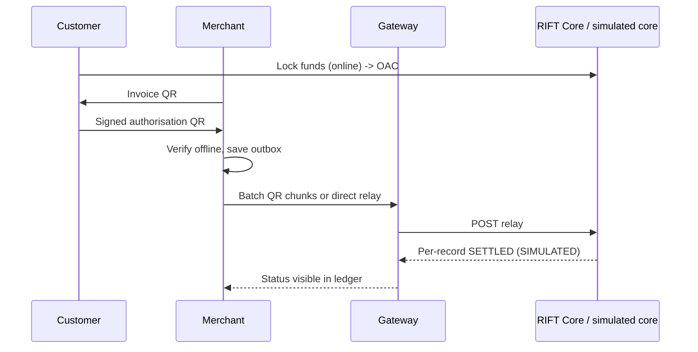

# User Flows

## Golden demo loop (must never break)

## Customer journey

1. Open app → RoleGate → Customer.
2. If live and unregistered, `registerLive()` registers keys; otherwise sticky demo.
3. Overview shows balances and actions.
4. Open RIFT → lock ₦5,000/₦10,000/₦20,000/Max.
5. Spend offline via QR → demo invoice or scan merchant QR.
6. Confirm amount → sign token → QR + raw token.
7. Wait for merchant acceptance → done state → reconcile when online.

## Merchant journey

1. RoleGate → Merchant.
2. Till → enter amount → Create invoice QR.
3. Customer scans invoice and returns authorisation QR.
4. Scan with camera (HTTPS only) or paste raw token; single-device demo uses Pull demo token.
5. Accept → green receipt → outbox row.
6. Receipts tab for filters; Sync & relay tab for batch export or direct relay.

## Gateway journey

1. RoleGate → Gateway.
2. Scan merchant batch QR chunks in any order or paste full JSON.
3. Review queued entries and SIG validity badge.
4. Relay selected or relay all.
5. Settlement ledger shows clearing references/rejection reasons.
6. Node monitor displays connectivity, mode, last relay and node id.

## Rehearsal client journey

1. Role selection → onboarding form with name, phone, role, PIN.
2. Registration with Core while online.
3. Set PIN if profile lacks credential; otherwise login with device-local PIN.
4. Customer: allocate OAC → scan invoice → confirm → auth QR.
5. Merchant: create invoice → scan auth → receipt → outbox/settlement.

## Failure journeys

- No backend: bank falls back to demo; rehearsal client blocks onboarding with `API_NOT_CONFIGURED`.
- HTTP LAN origin: scanner disabled; paste token path required.
- Live registration conflict: rotate keypair/phone/merchant code and retry once.
- Relay rejection: receipt remains with rejected/quarantined status; no real money movement.
- Browser restart: role, prefs, identities, OACs and outbox recovered from localStorage/IndexedDB.
